

My research uses large biodiversity, environmental and satellite datasets to ask where species are, how they are changing, and whether protection and management are keeping up. It runs from New Zealand rivers and coastlines to the global ocean, and almost all of it is built as reproducible code.

  
<b>13</b>peer-reviewed papers

  
<b>5</b>as first author

  
<b>1</b>more as a preprint

  
<b>5</b>scientific reports

  <a class="rs-btn" href="/Publications/">Full publication list</a>
  <a class="rs-btn ghost" href="https://scholar.google.com/citations?user=iiZ0klkAAAAJ&hl=en">Google Scholar</a>
  <a class="rs-btn ghost" href="/cv/#academic">Academic CV</a>

  Spatial conservation prioritisationReinforcement learningRandom forests and gradient forestsSpecies distribution and density modelsNull and permutation modelsMixed effects and quantile regressionFunctional and phylogenetic diversitySatellite and vessel-tracking dataR, Python and Quarto

In each list, a dark bar marks a first-author paper.

  

    <figure class="rs-fig">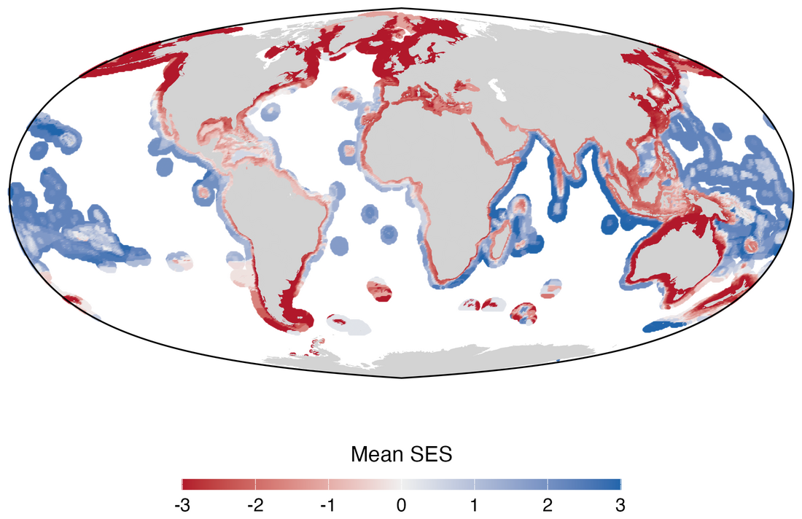<figcaption>Gap analysis: how well no-take protected areas cover species ranges compared with a null model of random placement (blue better, red worse than chance).</figcaption></figure>
    <figure class="rs-fig">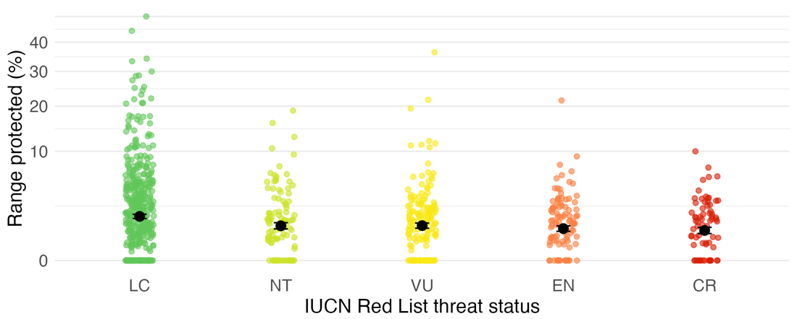<figcaption>Share of each species' range inside no-take protected areas, by IUCN Red List category: threatened species are no better covered.</figcaption></figure>
    <figure class="rs-fig">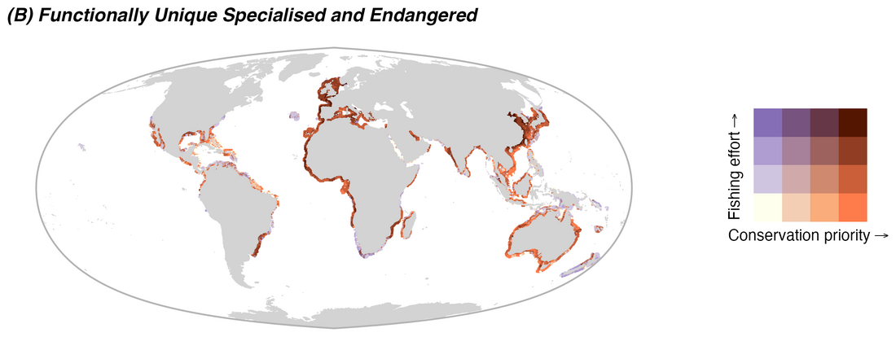<figcaption>Conservation priorities from reinforcement learning, set against industrial fishing effort.</figcaption></figure>
  

  

    
Global macroecology

    <h3>Area-based management and conservation prioritisation</h3>
    
How well does the global network of marine protected areas cover biodiversity, and where should new protection go? With the Pimiento Research Group, I combined range maps for about 1,000 species with measures of extinction risk, ecological function and evolutionary history. I ran a gap analysis against a spatially explicit null model, then used reinforcement learning to optimise where a 10% protection target would do the most good, set against where industrial fishing concentrates.

    
The study system is sharks and rays, one of the most threatened groups in the ocean; the methods apply to any taxon or region.

    <ul class="rs-papers">
      <li class="first"><strong>Mouton T.L.</strong> et al. <a href="https://doi.org/10.1101/2025.11.28.691085">Global gaps and priorities for shark and ray conservation.</a> <em>bioRxiv</em> preprint 2025</li>
      <li>Pimiento C. et al. <a href="https://doi.org/10.1038/s41467-023-43212-3">Functional diversity of sharks and rays is highly vulnerable and supported by unique species and locations worldwide.</a> <em>Nature Communications</em> 2023</li>
      <li>Kocáková K. et al. <a href="https://doi.org/10.1111/geb.70315">FINS: a global occurrence dataset of fossil neoselachians.</a> <em>Global Ecology and Biogeography</em> 2026 (<a href="https://fins-app.shinyapps.io/FINS_App/">app</a>)</li>
    </ul>
  

  

    <figure class="rs-fig">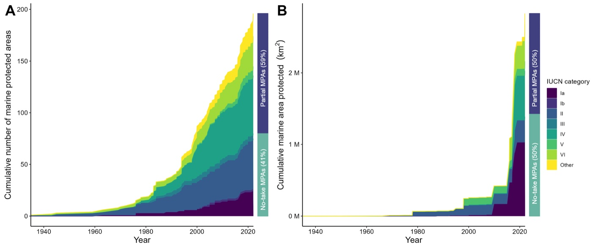<figcaption>Cumulative number (A) and area (B) of marine protected areas by IUCN category in the Central and South American Pacific, 1940 to 2023.</figcaption></figure>
    <figure class="rs-fig">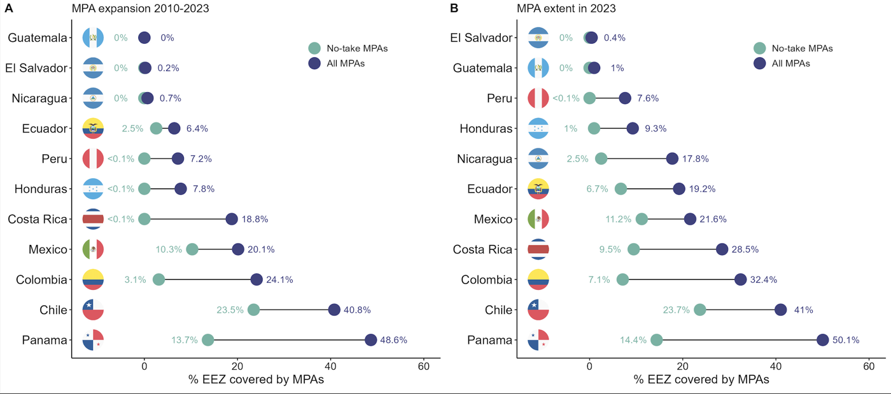<figcaption>Share of each country's exclusive economic zone under protection: expansion since 2010 (A) and extent in 2023 (B), no-take against all MPAs.</figcaption></figure>
  

  

    
Science to policy

    <h3>Protection gaps in critical habitat</h3>
    
As scientific coordinator for the IUCN SSC Shark Specialist Group, I worked with more than 60 experts to identify Important Shark and Ray Areas, then tested how well existing protected areas actually cover them. The answer, region after region, is very little, especially once fishing is taken into account.

    <ul class="rs-papers">
      <li class="first"><strong>Mouton T.L.</strong> et al. <a href="https://doi.org/10.1016/j.marpol.2024.106448">Shortfalls in the protection of Important Shark and Ray Areas undermine shark conservation efforts in the Central and South American Pacific.</a> <em>Marine Policy</em> 2024</li>
      <li>Cochran J.E.M. et al. <a href="https://doi.org/10.1002/ece3.72690">Only one percent of Important Shark and Ray Areas in the Western Indian Ocean are fully protected from fishing pressure.</a> <em>Ecology and Evolution</em> 2026</li>
      <li>Rohner C.A. et al. <a href="https://doi.org/10.1016/j.isci.2025.113192">Important Shark and Ray Areas can inform conservation planning in the Mediterranean and Black Seas.</a> <em>iScience</em> 2025</li>
      <li>Regional compendia: <a href="https://doi.org/10.59216/ssg.isra.2023.r3">Mediterranean and Black Seas</a> 2023, <a href="https://doi.org/10.59216/ssg.isra.2023.r7">Western Indian Ocean</a> 2024</li>
    </ul>
  

  

    <figure class="rs-fig">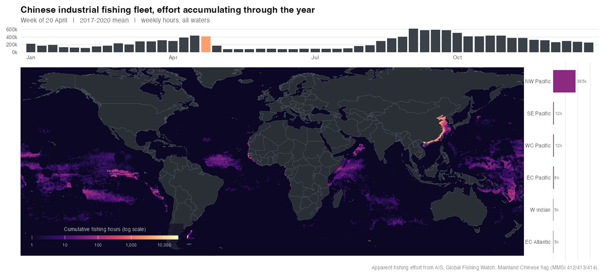<figcaption>A year of Chinese industrial fishing effort accumulating week by week, from AIS data (frame from the animation).</figcaption></figure>
    <figure class="rs-fig">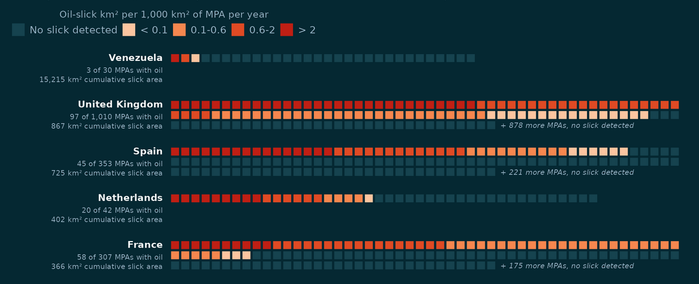<figcaption>Oil slicks inside marine protected areas, 2023 to 2025: each square is one MPA, coloured by the oil detected inside it, for the five most exposed countries.</figcaption></figure>
  

  

    
Open analyses

    <h3>Human pressure at sea, seen from space</h3>
    
Much of my recent work uses public satellite data to measure human activity at sea: industrial fishing from vessel tracking (AIS) and Sentinel-1 radar, and oil pollution from radar slick detections. These are open, reproducible analyses, each with its code.

    <ul class="rs-papers">
      <li><a href="https://github.com/TheophileMt92/gfw-chinese-fleet">A year of Chinese fleet effort</a>, animated</li>
      <li><a href="https://github.com/TheophileMt92/fishing-effort-beyond-ais">Mapping fishing effort beyond AIS</a>: a random forest on paired AIS and radar detections</li>
      <li><a href="https://theophilemt92.github.io/gfw-fleet-comparison/">How the world's industrial fishing fleets compare</a>, and how much the answer depends on what you divide by</li>
      <li><a href="https://theophilemt92.github.io/mpa-oil-slicks/">Oil slicks inside marine protected areas</a>, 2023 to 2025</li>
    </ul>
  

  

    <figure class="rs-fig">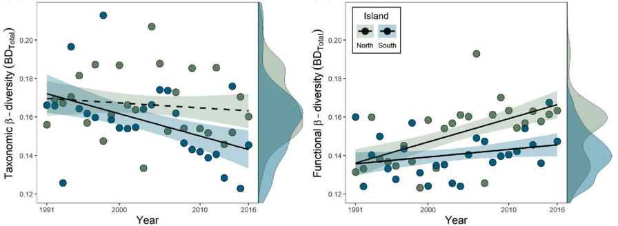<figcaption>Taxonomic homogenisation and functional differentiation in New Zealand rivers.</figcaption></figure>
    <figure class="rs-fig">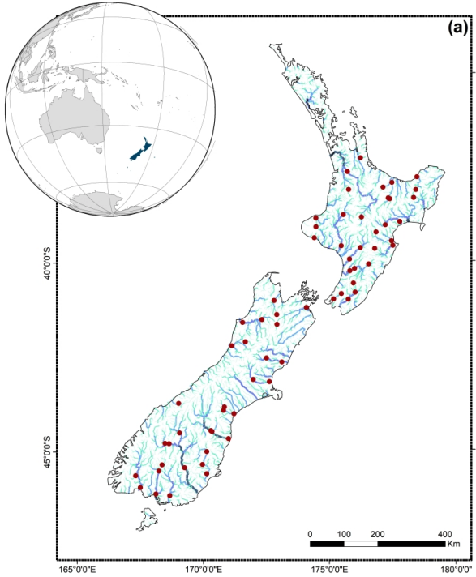<figcaption>The national river monitoring sites behind the <em>Global Change Biology</em> study.</figcaption></figure>
  

  

    
Global change

    <h3>Biodiversity change under climate and land use</h3>
    
My PhD used three decades of national monitoring data to separate the effects of climate and land use on freshwater communities, showing that species composition and ecological function can respond in opposite directions. Related work tracks how nutrient enrichment reshapes coastal lagoon communities.

    <ul class="rs-papers">
      <li class="first"><strong>Mouton T.L.</strong> et al. <a href="https://doi.org/10.1111/gcb.15389">Increasing climate-driven taxonomic homogenization but functional differentiation among river macroinvertebrate assemblages.</a> <em>Global Change Biology</em> 2020</li>
      <li class="first"><strong>Mouton T.L.</strong> et al. <a href="https://doi.org/10.1111/ecog.06148">Climate and land-use driven reorganisation of structure and function in river macroinvertebrate communities.</a> <em>Ecography</em> 2022</li>
      <li class="first"><strong>Mouton T.L.</strong> et al. <a href="https://doi.org/10.1016/j.scitotenv.2018.12.277">Environmental filtering of native and non-native stream macrophyte assemblages.</a> <em>Science of the Total Environment</em> 2019</li>
      <li>Jones A.G. et al. <a href="https://doi.org/10.24072/pcjournal.499">Disentangling the effects of eutrophication and natural variability on macrobenthic communities across French coastal lagoons.</a> <em>Peer Community Journal</em> 2024</li>
    </ul>
  

  

    <figure class="rs-fig">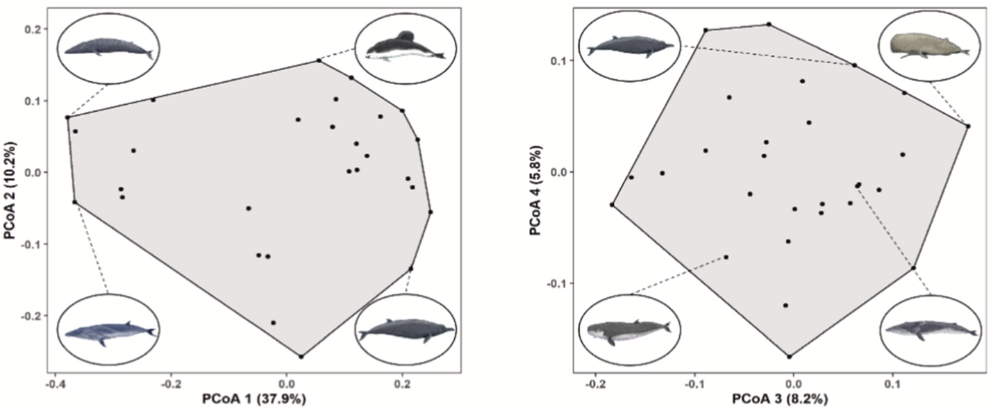<figcaption>Mismatch between diversity facets of New Zealand cetaceans.</figcaption></figure>
    <figure class="rs-fig">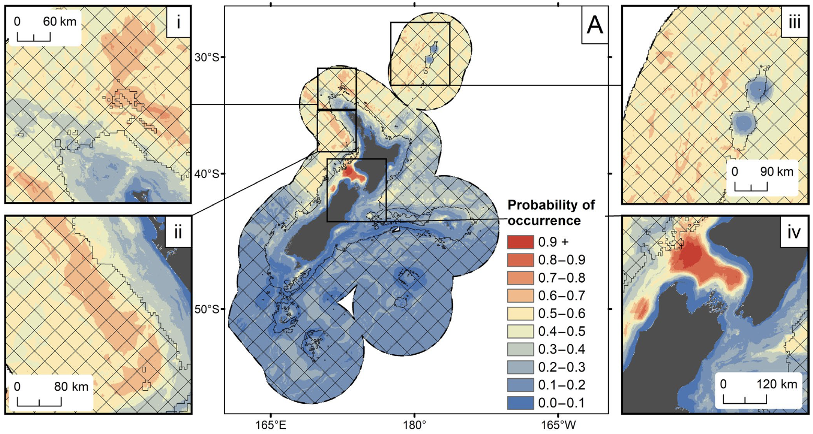<figcaption>Modelled probability of occurrence of a cetacean species across New Zealand's waters, with zoomed insets (Stephenson et al. 2020).</figcaption></figure>
  

  

    
National scale

    <h3>Mapping and protecting marine life in New Zealand</h3>
    
At NIWA I modelled where New Zealand's whales and dolphins live and classified its seafloor communities with machine learning, work that fed conservation planning for Fisheries New Zealand and the Department of Conservation.

    <ul class="rs-papers">
      <li class="first"><strong>Mouton T.L.</strong> et al. <a href="https://doi.org/10.1016/j.biocon.2022.109484">Spatial mismatch in diversity facets reveals contrasting protection for New Zealand's cetacean biodiversity.</a> <em>Biological Conservation</em> 2022</li>
      <li>Stephenson F. et al. <a href="https://doi.org/10.1111/ddi.13035">Modelling the spatial distribution of cetaceans in New Zealand waters.</a> <em>Diversity and Distributions</em> 2020</li>
      <li>Stephenson F. et al. <a href="https://doi.org/10.1002/ecs2.3633">Cetacean conservation planning in a global diversity hotspot.</a> <em>Ecosphere</em> 2021</li>
      <li>Stephenson F. et al. <a href="https://doi.org/10.3389/fmars.2021.792712">Development of a seafloor community classification for the New Zealand region using a gradient forest approach.</a> <em>Frontiers in Marine Science</em> 2022</li>
    </ul>
  

