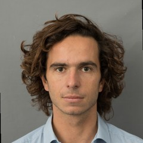
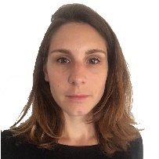
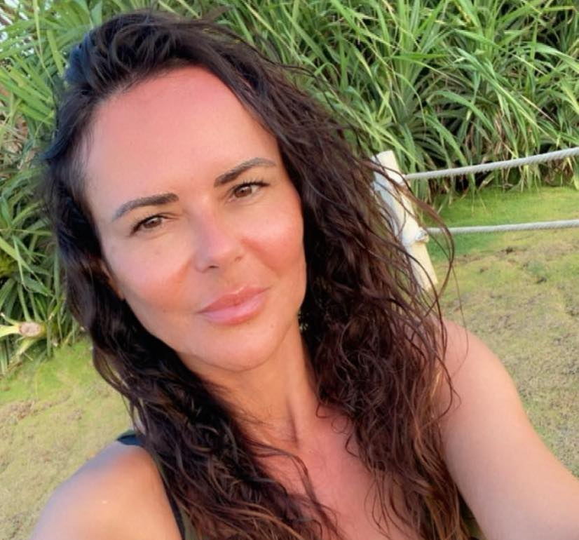
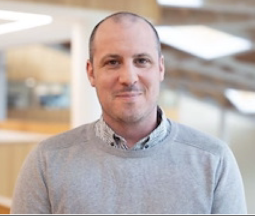
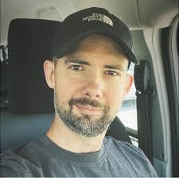
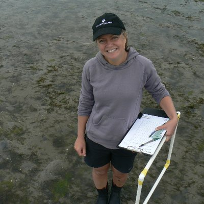

  
<b>Worked with me?</b> I'd be grateful for a few words about the experience.<small>Email is private. GitHub submissions are public until they're published here.</small>

  
<a class="tm-btn" href="mailto:theophile.mouton92@gmail.com?subject=Testimonial%20for%20theophile-mouton.com&body=Hi%20Th%C3%A9ophile%2C%0A%0AHere%20is%20a%20testimonial%20for%20your%20website.%0A%0AName%20%28as%20it%20should%20appear%29%3A%0ARole%20and%20organisation%3A%0AHow%20we%20worked%20together%3A%0A%0ATestimonial%3A%0A%0A%0AI%20agree%20to%20my%20name%2C%20role%20and%20testimonial%20being%20published%20on%20theophile-mouton.com.%0A">Send by email</a> <a class="tm-btn ghost" href="https://github.com/TheophileMt92/theophile-mouton/issues/new?template=testimonial.yml">Submit on GitHub</a>

  <blockquote class="tm-card">
    

Théophile and I have teamed up on several data science projects, and it’s always a pleasure. He’s productive, solution-oriented, curious, and delivers top-quality work every time. I can’t recommend him highly enough.

    <button class="tm-toggle" type="button" hidden>Read more</button>
    <footer><b>Yan Holtz</b>Creator of the R, Python and React Graph Galleries and Data-to-Viz</footer>
  </blockquote>
  <blockquote class="tm-card">
    

I met Théophile at a coworking space while we were both working with Yan Holtz. Since then, we've stayed in touch and become collaborators, although we haven't had the opportunity to work on a project together yet. I've had the chance to get to know his work and really enjoy our discussions about data science and technical challenges. Théophile is dedicated, thoughtful, and takes his work seriously, while always being approachable and pleasant to interact with. I'm looking forward to collaborating more closely with him in the future!

    <button class="tm-toggle" type="button" hidden>Read more</button>
    <footer><b>Joseph Barbier</b>Data scientist, freelance</footer>
  </blockquote>
  <blockquote class="tm-card">
    

We brought Theo on board as a freelancer to develop a data visualization dashboard for our research publications. He approached the project with enthusiasm and flexibility, helping us bring our vision to life.

Theo built an efficient tool utilizing Shiny for generating plots and tables from our data, while ensuring everything aligned with our organization's mission and visual brand.

Even while working fully remotely, communication with him was smooth, and we were able to address any feedback quickly and collaboratively.

We highly recommend working with him!

    <button class="tm-toggle" type="button" hidden>Read more</button>
    <footer><b>Juan Vivanco</b>Citizens for Europe</footer>
  </blockquote>
  <blockquote class="tm-card">
    

I had the pleasure of working with Théo on a 10-day freelance project involving R coding and data visualization. Théo is not only highly skilled but also very approachable and easy to communicate with. He quickly understood the project's requirements and delivered high-quality results.

He is exceptionally organized, and his outputs, including Quarto scripts, were impeccable and well-documented. His professionalism and efficiency made the entire process smooth and enjoyable. I would highly recommend Théo for any project requiring expertise in data analysis and visualization.

    <button class="tm-toggle" type="button" hidden>Read more</button>
    <footer><b>Dr. Muriel Gros-Balthazard</b>French National Research Institute for Sustainable Development</footer>
  </blockquote>
  <blockquote class="tm-card">
    

During Theo's time as a postdoctoral researcher with the IUCN Species Survival Commission's Shark Specialist Group and the Important Shark and Ray Areas (ISRA) initiative, he played a crucial role in coordinating ISRA proposals for the Western Indian Ocean.

As the coordinator for Mauritius, Theo's leadership was instrumental in our successful collaboration, resulting in the designation of Egmont Atoll in the Chagos Archipelago, a vital habitat for reef manta rays.

His expertise and guidance were key to this achievement, marking a significant milestone for reef manta ray conservation efforts in the Indian Ocean.

    <button class="tm-toggle" type="button" hidden>Read more</button>
    <footer><b>Dr. Joanna Harris</b>University of Plymouth</footer>
  </blockquote>
  <blockquote class="tm-card">
    

I was Theo's main collaborator while working as a marine scientist at the National Institute of Water and Atmospheric Research in New Zealand.

I truly enjoyed working with Theo, as he demonstrated a strong eagerness to deliver innovative and impactful work. His work was crucial in the preparation, analyses and delivery of important scientific reports and publications.

I was particularly impressed by his rapid understanding of machine learning models and GIS tools, by his ability to work independently in a foreign country and to quickly develop strong professional skills.

I can highly recommend working with Theo!

    <button class="tm-toggle" type="button" hidden>Read more</button>
    <footer><b>Dr. Fabrice Stephenson</b>Newcastle University</footer>
  </blockquote>
  <blockquote class="tm-card tm-extra">
    

I had the pleasure of being Theo's PhD co-supervisor at the University of Montpellier.

Throughout his PhD journey, Theo demonstrated exceptional leadership and self-motivation, driving his research program with remarkable independence.

I was consistently impressed by Theo's ability to assemble a team of international experts, develop sophisticated programming pipelines, and by his outstanding writing skills. His clear communication in both French and English was evident throughout his work.

His efforts culminated in the publication of four manuscripts in highly regarded journals, a remarkable achievement that far exceeds the expectations for an early-career scientist and is a true testament to his productivity.

On the day of his defense, I expressed my gratitude to Theo for allowing me to supervise his research, as the experience was enriching for me as well.

I highly recommend working with him!

    <button class="tm-toggle" type="button" hidden>Read more</button>
    <footer><b>Prof. Fabien Leprieur</b>University of Montpellier</footer>
  </blockquote>
  <blockquote class="tm-card tm-extra">
    

I hired Theo as a research assistant at the National Institute of Water and Atmospheric Research in New Zealand. Theo provided remarkable leadership in the research program I entrusted him with and demonstrated an impressive capacity to quickly learn and apply modern programming and statistical skills.

    <button class="tm-toggle" type="button" hidden>Read more</button>
    <footer><b>Dr. Fleur Matheson</b>New Zealand's National Institute for Water and Atmospheric Research</footer>
  </blockquote>

<button type="button" id="tm-more">See more testimonials</button>

