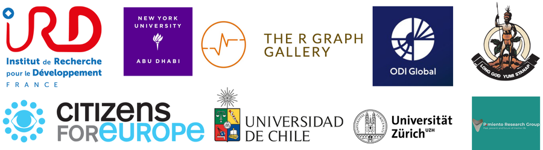
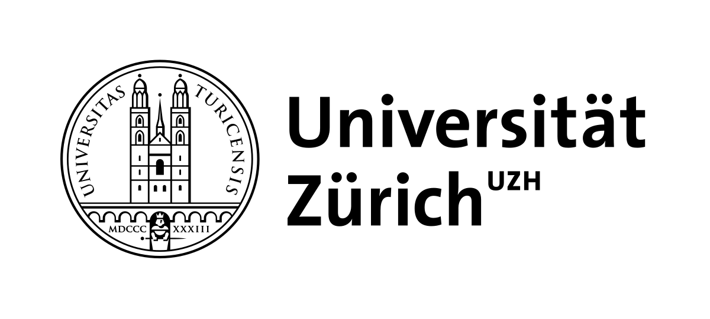
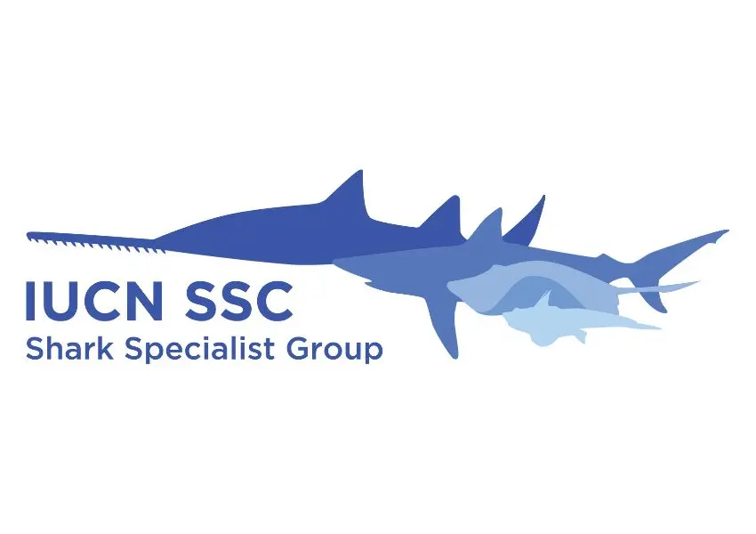
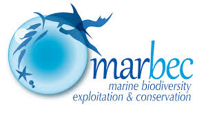
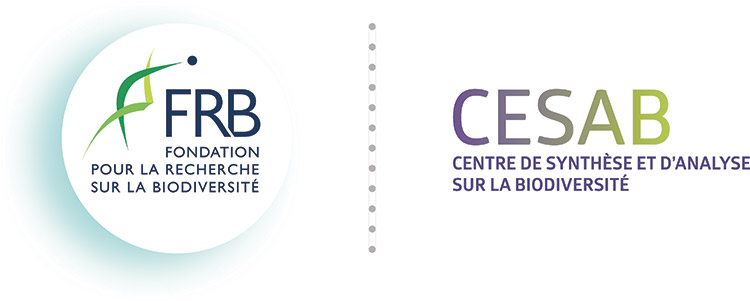
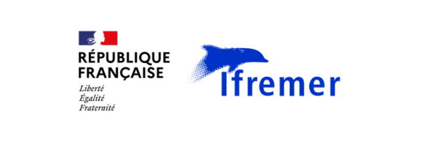
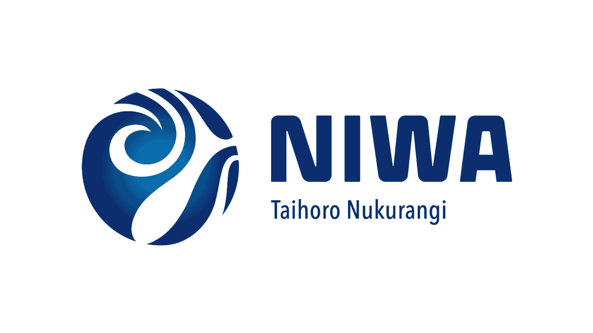

Ten years of data science across consultancy, universities, research institutes and international organisations, in New Zealand, France and Switzerland. Most recent first.

  <a class="wx-btn" href="/cv/">Download my CV</a>
  <a class="wx-btn ghost" href="/portfolio/">See the work</a>

  

    

      

DSA

      
<h3>Founder and Data Consultant</h3>
DataSphere Analytics &middot; Montpellier, remote

      2024 - present
    

    <ul>
      <li>Design, build and ship interactive Shiny applications end to end for research institutions, NGOs and government clients, from scoping to deployment and handover: <a href="https://fins-app.shinyapps.io/FINS_App/">FINS Explorer</a> and SAFE for the University of Zurich, <a href="https://cloudapps.france-bioinformatique.fr/dateback/">DateBack</a> for IRD and CNRS, and a survey dashboard with continuous integration for <a href="https://citizensforeurope.org/">Citizens for Europe</a>.</li>
      <li>Built, with Yan Holtz, an automated Quarto pipeline for the Government of Vanuatu that turns a cyclone scenario into a costed damage and response assessment (<a href="https://theophilemt92.github.io/vanuatu-disaster-report-demo/">public demo</a>).</li>
      <li>Led a working group's data pipeline at the Global Fishing Watch Mediterranean Data Lab (Rome, October 2026): one GitHub repository, a <a href="https://theophilemt92.github.io/gfw-med-data-lab/climate-env-ais/Quarto_report_CLIMATE-ENV-AIS.html">live Quarto report</a> and <a href="https://theophilemt92.github.io/gfw-med-data-lab/climate-env-ais/Quarto_slides_CLIMATE-ENV-AIS.html">slides that update themselves</a>.</li>
      <li>Wrote data visualisation tutorials for the R Graph Gallery (<a href="https://r-graph-gallery.com/character-interaction-analysis.html">chord diagram</a>, <a href="https://r-graph-gallery.com/web-sankey-diagram-with-highlight.html">Sankey with highlight</a>, <a href="https://r-graph-gallery.com/web-sankey-refugees.html">refugee flows</a>) and publication-ready network figures for the University of Chile.</li>
      <li>Published a reusable, branded <a href="https://theophilemt92.github.io/quarto-report-template/">Quarto report template</a> and a series of open analyses of satellite and vessel-tracking data, listed on the <a href="/portfolio/">portfolio</a>.</li>
    </ul>
    
    
RShinyQuartoPythonGit and GitHubClient delivery

  

  

    

      

      
<h3>Data Scientist, Postdoctoral Researcher</h3>
IRD, French National Research Institute for Sustainable Development, BRIDGES programme &middot; Montpellier

      Jan - Jul 2026
    

    <ul>
      <li>Built an LLM-assisted extraction pipeline in Python with the Anthropic Claude API, pulling 27 structured fields from a corpus of more than 3,000 documents.</li>
      <li>Validated it at scale against blind manual coding: inter-rater agreement (Gwet's AC1), cluster bootstrap confidence intervals and McNemar's test.</li>
      <li>Delivered the screening and analysis system as a documented <a href="https://github.com/TheophileMt92/BRIDGES_litterature">public GitHub repository</a>, structured for reuse by the client team.</li>
    </ul>
    
PythonLLMsAgreement statisticsReproducibility

  

  

    

      

      
<h3>Data Scientist, Postdoctoral Researcher</h3>
University of Zurich, Pimiento Research Group &middot; remote from Montpellier

      2025
    

    <ul>
      <li>Led a global conservation prioritisation of sharks and rays with CAPTAIN, a reinforcement learning algorithm in Python, optimising across about 1,000 species and three conservation criteria. Manuscript in revision at <em>Science Advances</em> (<a href="https://doi.org/10.1101/2025.11.28.691085">preprint</a>, <a href="https://github.com/TheophileMt92/CAPTAIN_elasmo_manuscript">code</a>).</li>
      <li>Trained a random forest on paired AIS and Sentinel-1 radar data to estimate fishing effort where vessels stop broadcasting (<a href="https://github.com/TheophileMt92/fishing-effort-beyond-ais">repo</a>).</li>
      <li>Ran a gap analysis of the global marine protected area network against a spatially explicit null model, with quantile and beta regression.</li>
      <li>Built the <a href="https://fins-app.shinyapps.io/FINS_App/">FINS</a> and SAFE Shiny applications for the group's open datasets (<a href="https://doi.org/10.1111/geb.70315">FINS paper</a>).</li>
    </ul>
    
Machine learningReinforcement learningSatellite dataR and Python

  

  

    

      

      
<h3>Postdoctoral Researcher and Scientific Coordinator</h3>
IUCN SSC Shark Specialist Group, Important Shark and Ray Areas &middot; remote

      2023 - 2024
    

    <ul>
      <li>Coordinated more than 60 scientists across international institutions to design, write, review and publish the regional compendia for the <a href="https://sharkrayareas.org/download/mediterranean-and-black-seas-regional-compendium-of-important-shark-and-ray-areas/">Mediterranean and Black Seas</a> and the <a href="https://sharkrayareas.org/download/western-indian-ocean-regional-compendium-of-important-shark-and-ray-areas/">Western Indian Ocean</a>, to deadline.</li>
      <li>Co-organised and delivered two expert workshops with more than 250 participants in total, in Thessaloniki and Durban.</li>
      <li>Led an analysis of protection shortfalls in the Central and South American Pacific with text mining, mixed effects models and spatial overlaps, published in <a href="https://www.sciencedirect.com/science/article/pii/S0308597X24004482"><em>Marine Policy</em></a>.</li>
    </ul>
    
CoordinationWorkshops and trainingStakeholdersSpatial analysis

  

  

    

      

      
<h3>PhD in Macroecology (statistical modelling)</h3>
MARBEC, University of Montpellier, degree from Université Claude Bernard Lyon 1

      2020 - 2023
    

    <ul>
      <li>Compiled, cleaned and modelled a 30-year database spanning 70 sites and more than 100 variables (biodiversity, climate, land use and habitat), building the full workflow in R.</li>
      <li>Assembled and managed a team of 15 scientists across three continents.</li>
      <li>Published three first-author papers, including <a href="https://onlinelibrary.wiley.com/doi/abs/10.1111/gcb.15389"><em>Global Change Biology</em></a> and <a href="https://nsojournals.onlinelibrary.wiley.com/doi/10.1111/ecog.06148"><em>Ecography</em></a> (<a href="https://theses.fr/275299554">thesis</a>).</li>
    </ul>
    
Statistical modellingLarge datasetsRTeam leadership

  

  

    

      

      
<h3>Research Scientist</h3>
CESAB, French Foundation for Research on Biodiversity &middot; Montpellier

      2021 - 2022
    

    <ul>
      <li>Built end-to-end R pipelines to format, clean and analyse a database of more than 9 million rows linking human population growth to protected area establishment across the United States over two centuries.</li>
      <li>Contributed to the <a href="https://parsecproject.org">PARSEC</a> project on reproducible, collaborative data science.</li>
    </ul>
    
Data pipelinesRCensus and land-use data

  

  

    

      

      
<h3>Research Scientist</h3>
Ifremer, French Research Institute for Exploitation of the Sea &middot; Sète

      2019 - 2020
    

    <ul>
      <li>Supported a coastal ecological monitoring network with data cleaning, analysis and reporting, and ran its fieldwork and laboratory campaigns.</li>
      <li>Led a mixed-method project: a trait database, multivariate statistics and generalised models, with weekly reporting to an expert panel (<a href="https://doi.org/10.24072/pcjournal.499">paper</a>).</li>
      <li>Hired and supervised an MSc student.</li>
    </ul>
    
Monitoring dataMultivariate statisticsSupervision

  

  

    

      

      
<h3>Research Assistant</h3>
NIWA, National Institute of Water and Atmospheric Research &middot; Hamilton, New Zealand

      2017 - 2019
    

    <ul>
      <li>Statistical programming, data processing and multivariate analyses for three research groups in marine and freshwater science.</li>
      <li>Species distribution modelling of New Zealand cetaceans and marine spatial classification with machine learning, for Fisheries New Zealand and the Department of Conservation (<a href="https://docs.niwa.co.nz/library/public/NZAEBR-240.pdf">report</a>, <a href="https://onlinelibrary.wiley.com/doi/full/10.1111/ddi.13035">paper</a>).</li>
      <li>Led a first-author paper in <a href="https://www.sciencedirect.com/science/article/abs/pii/S0048969718351507"><em>Science of the Total Environment</em></a> and co-supervised an MSc student.</li>
    </ul>
    
Machine learningSpecies distribution modelsData visualisation

  

<h2 class="wx-sec">Education</h2>

  
<b>PhD in Macroecology</b>Université Claude Bernard Lyon 1, research at the University of Montpellier 2020 - 2023

  
<b>MSc Dynamics of Aquatic Ecosystems</b>University of Pau and Pays de l'Adour, thesis at Massey University, New Zealand 2014 - 2016

  
<b>BSc Ecology and Organismal Biology</b>University of Montpellier 2012 - 2014

